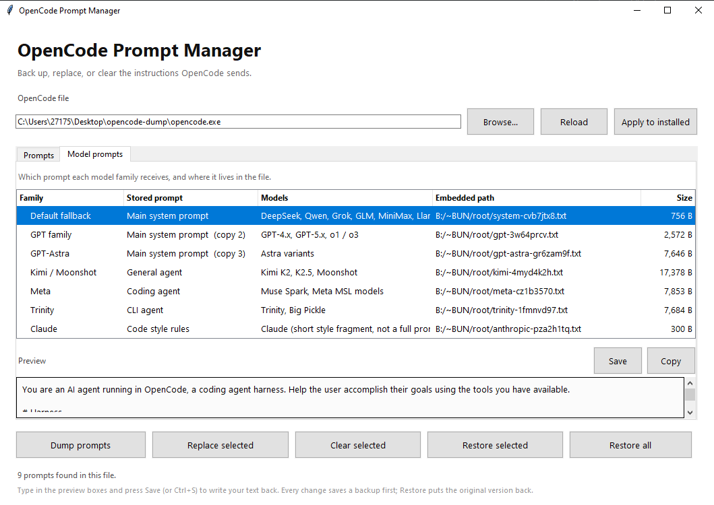

# Opencode-SystemPrompt manager

Read, replace, or clear the system prompts compiled into `opencode.exe`.




> [!WARNING]
> This tool edits a program made by someone else: it may violate OpenCode's terms, can break the software, and patches vanish when OpenCode updates. Use it on a copy, keep backups, never redistribute a modified `opencode.exe`, and accept the risk.

## Quick start

```text
1. Copy opencode.exe into this folder
2. Run OpenCode Prompt Manager.exe
3. Pick a prompt, edit the preview box, press Save (or Ctrl+S)
4. Happy? Apply to installed so real `opencode` runs use it too
```

## Tabs and buttons

- **Prompts** — every prompt in the file with its size and an editable preview box. Shorter messages are fine: the leftover space is padded automatically and never shown as part of your text. A replacement can only be as long as the prompt it replaces — need more room? Set `system` per agent in `opencode.jsonc`, which has no length limit.
- **Model prompts** — which model family receives which prompt. The **Stored prompt** column names the very same prompt as in the Prompts tab; clearing a row clears those same bytes. Right-click a row to jump to it.
- **Dump prompts** — saves every prompt as `.txt` under `backups\`.
- **Replace selected** — swaps a prompt for a text file you choose. **Clear selected** — blanks it.
- **Restore selected / Restore all** — always go back to the **true original**, never "the last change". The original texts and a pristine exe copy are saved under `backups\` the first time an untouched file is changed; if they are missing, the oldest matching backup is adopted as the original.

## Which file gets changed?

The app edits the file shown in **OpenCode file** — by default your copy in this folder; the installed exe under `%APPDATA%\npm\...` is only touched by **Apply to installed**, which backs it up first.

There is no separate "bun server" behind OpenCode: `opencode.exe` is a single Bun executable with everything bundled inside, prompts included. Whatever exe actually runs is the one whose prompts are used — an npm update replaces the installed exe with a fresh, unmodified one, so keep your edited copy here and hit **Apply to installed** again after updating. Close OpenCode while changing the file.

## Which model family gets which prompt

OpenCode picks one system prompt per model family (verified against the exe, Bun 1.4.4 build):

| Model family | Receives | Size |
|---|---|---|
| Default fallback | Main system prompt | ~756 chars |
| GPT family | Main system prompt (copy 2) | ~2,572 chars |
| GPT-Astra | Main system prompt (copy 3) | ~3,823 chars |
| Kimi / Moonshot | General agent | ~8,689 chars |
| Meta | Coding agent | ~7,853 chars |
| Trinity | CLI agent | ~7,684 chars |
| Claude | Code style rules (fragment) | ~300 chars |

Role-based prompts are sent regardless of family: **File search agent** (~654 chars) for search subagents, and the **Code reviewer** prompt (~4,576 chars) when you run `/review`.

## Template variables

Only two `$` placeholders exist in all the prompts — both are filled in by OpenCode at runtime, per request (swept the whole exe, utf8 + utf16; every other `$` match in the binary is bundled JavaScript code):

| Variable | Used in | Replaced with |
|---|---|---|
| `${OPENCODE_TOOL_GUIDANCE}` | Main system prompt + both copies | joined per-tool guidance, built from the enabled tools for that request |
| `$ARGUMENTS` | Code reviewer | the text you type after `/review`; with no placeholder present it is appended at the end instead |

Keep `${OPENCODE_TOOL_GUIDANCE}` in a replaced main prompt to keep the per-tool guidance flowing; dropping it just removes that block. The full dumped prompt texts are in [`prompts\`](prompts/).

## Files

```text
ocprompt.pyw                  source
OpenCode Prompt Manager.exe   the app
prompts\                      the dumped prompt texts (committed)
regions.json                  cached prompt locations (not committed)
backups\                      originals, per-change backups and dumps (not committed)
```
